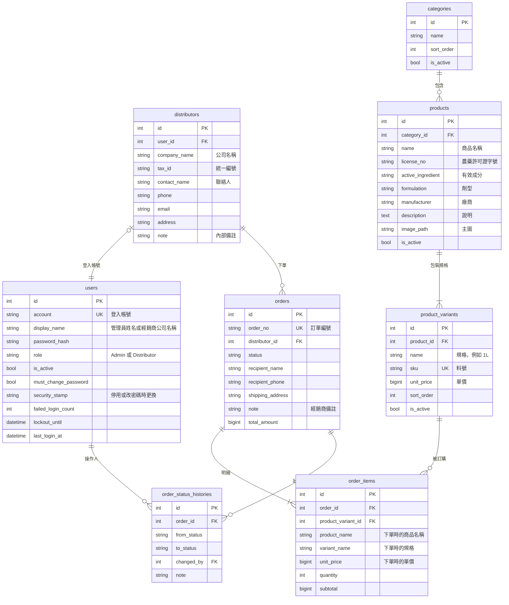

# 農藥經銷 B2B 訂購平台：開發計畫

- 最後更新：2026-10-24
- 重要決策的原因記錄在 [ADR](adr/README.md)
- 需求確認的結果記錄在[第 9 節](#9-需求確認紀錄)

## 1. 專案目標

建立一個讓農藥經銷商在線上訂貨的 B2B 平台後端：

- 首頁展示公司簡介與聯絡資訊
- 經銷商登入後瀏覽商品、下單、查詢自己的訂單
- 管理員在後台管理經銷商帳號、商品與訂單

## 2. 使用者角色

| 角色 | 說明 | 能做的事 |
|---|---|---|
| 訪客 | 未登入 | 看公司簡介、聯絡資訊 |
| 經銷商 | 由管理員建立帳號 | 瀏覽商品與價格、下單、查詢及取消自己的訂單、修改密碼 |
| 管理員 | 公司內部人員，可以有多位，權限都相同 | 管理經銷商、商品、分類、訂單，以及其他管理員帳號 |

## 3. 範圍

### 第一版包含

- 公司簡介、聯絡資訊（寫死在前端，見 [ADR-0015](adr/0015-site-content-in-frontend.md)）
- 帳號登入、修改密碼
- 後台經銷商管理（新增、編輯、停用、重設密碼）
- 後台管理員帳號管理（新增、編輯、停用、重設密碼）
- 商品分類與商品管理（含包裝規格、上下架、圖片）
- 經銷商下單、查詢訂單、取消待確認的訂單
- 後台訂單管理與狀態流程

### 第一版不包含

| 項目 | 備註 |
|---|---|
| 線上金流 | 見 [ADR-0004](adr/0004-orders-without-payment-gateway.md) |
| 經銷商自行註冊、忘記密碼自助重設 | 由管理員處理，見 [ADR-0003](adr/0003-admin-created-distributor-accounts.md) |
| 分級價格、個別經銷商專屬價格 | 所有經銷商同一價格 |
| 稅額計算、運費 | 價格一律含稅，不收運費 |
| 管理員分級權限 | 所有管理員權限相同，見 [ADR-0010](adr/0010-admin-accounts-with-equal-permissions.md) |
| 一家經銷商多個登入帳號 | 一家一個帳號 |
| 農藥販賣業執照管理 | |
| 信用額度、月結對帳 | |
| 庫存管理 | 見 [ADR-0009](adr/0009-no-inventory-tracking-in-v1.md) |
| 電子發票、物流串接 | |
| Email / LINE 通知 | |
| 報表 | |

## 4. 技術選型

| 項目 | 選擇 | ADR |
|---|---|---|
| 架構 | ASP.NET Core Web API + 獨立前端 | [0001](adr/0001-web-api-and-separate-frontend.md) |
| 執行環境 | .NET 10 | |
| 資料庫 | PostgreSQL，透過 EF Core + Npgsql 存取 | [0002](adr/0002-postgresql-and-ef-core.md) |
| 認證 | JWT，分管理員與經銷商兩種角色 | [0005](adr/0005-jwt-authentication.md) |
| 專案結構 | 單一 API 專案，依功能分資料夾 | [0006](adr/0006-single-api-project.md) |
| API 文件 | 內建 OpenAPI + Scalar 測試頁 | |
| 本機開發資料庫 | Docker Compose | |
| 測試 | xUnit + Testcontainers（跑真的 PostgreSQL） | |
| 開發流程 | 先寫規格和測試再實作（`docs/specs/`），規格確認前由 hook 擋下程式修改，確認後的修改要經過使用者同意 | [0011](adr/0011-spec-first-tdd-and-ci.md)、[0013](adr/0013-hook-enforced-spec-confirmation.md)、[0014](adr/0014-changes-after-spec-confirmation.md) |
| 審查 | 完成前交給沒有上下文的 agent，對照規格並找 bug | [0012](adr/0012-fresh-context-review.md) |
| 程式碼檢查 | 警告視為錯誤、.NET 程式碼分析規則、`.editorconfig` | [0011](adr/0011-spec-first-tdd-and-ci.md) |
| CI | GitHub Actions：每個 PR 檢查格式、建置和測試 | [0011](adr/0011-spec-first-tdd-and-ci.md) |
| 前端 | React 或 Vue，待定 | |

## 5. 功能規格

### 5.1 網站內容（公司簡介）

- 公司簡介、聯絡資訊寫死在前端，後端不提供 API，見 [ADR-0015](adr/0015-site-content-in-frontend.md)

### 5.2 帳號與認證

- 用帳號和密碼登入，成功後回傳 JWT
- 密碼以雜湊儲存
- 管理員建立帳號或重設密碼後，使用者第一次登入必須改密碼
- 帳號停用後立即無法使用，包含還沒過期的 token（做法見 [ADR-0005](adr/0005-jwt-authentication.md)）
- 連續登入失敗 5 次，鎖定 15 分鐘
- 系統第一次啟動時，依設定檔建立預設管理員

### 5.3 經銷商管理（後台）

- 經銷商資料：公司名稱、統一編號、聯絡人、電話、Email、地址、內部備註
- 新增經銷商時一併建立登入帳號，系統隨機產生初始密碼，只顯示一次
- 可以編輯、停用或啟用、重設密碼
- 經銷商不刪除，只停用，避免舊訂單的資料斷掉
- 列表可依公司名稱、統一編號搜尋

### 5.4 管理員帳號管理（後台）

- 可以有多位管理員，權限都相同，見 [ADR-0010](adr/0010-admin-accounts-with-equal-permissions.md)
- 管理員資料：登入帳號、姓名
- 任何一位管理員都可以新增、編輯、停用或啟用其他管理員，也可以重設他們的密碼
- 初始密碼和重設密碼的規則與經銷商相同
- 管理員不能停用自己，所以系統一定會留下至少一位啟用中的管理員
- 管理員帳號不刪除，只停用，訂單歷程才查得到當時是誰操作的

### 5.5 商品與分類

- 分類：名稱、排序、上下架（第一版只有一層）
- 商品：名稱、農藥許可證字號、有效成分、劑型、廠商、說明、主圖、分類、上下架
- 包裝規格：每個商品可有多個規格（例如 250ml、1L），各自有料號和單價，見 [ADR-0007](adr/0007-product-package-variants.md)
- 商品與規格都只停用，不刪除
- 經銷商端可依分類篩選、用關鍵字搜尋（名稱、有效成分、許可證字號），結果分頁；只看得到上架的商品與規格
- 價格一律含稅，要登入才看得到，見 [ADR-0008](adr/0008-prices-visible-after-login.md)
- 圖片第一版存在伺服器的資料夾，之後可改存雲端

### 5.6 訂單

下單：

- 經銷商選好規格和數量後送出，購物車由前端暫存
- 收件人、電話、地址預設帶入經銷商資料，下單時可以修改
- 可以填備註
- 伺服器重新檢查規格是否還在上架，價格以伺服器當下的價格為準
- 訂單明細存下當時的商品名稱、規格、單價，之後改價不會影響舊訂單
- 訂單編號格式為 `yyyyMMdd-流水號`，例如 `20261024-0001`
- 價格一律含稅，系統不另外計算稅額
- 不收運費，訂單總額就是所有明細小計的加總

狀態流程：

| 狀態變更 | 誰可以操作 |
|---|---|
| 待確認 → 已確認 | 管理員 |
| 待確認 → 已取消 | 經銷商、管理員 |
| 已確認 → 已出貨 | 管理員 |
| 已確認 → 已取消 | 管理員 |
| 已出貨 → 已完成 | 管理員 |

- 程式裡的狀態值：`Pending`、`Confirmed`、`Shipped`、`Completed`、`Cancelled`
- 上表以外的狀態變更一律拒絕
- 每次狀態變更都記錄歷程：原狀態、新狀態、操作人、時間、備註
- 經銷商只看得到自己的訂單
- 後台訂單列表可依狀態、經銷商、日期區間篩選

## 6. 資料模型草稿

共通規則：

- 每張資料表都有 `created_at`、`updated_at`
- 時間一律存 UTC（`timestamptz`），顯示時再轉成台灣時間
- 金額只用整數（新台幣元），資料庫用 `bigint`，C# 端用 `long`，見 [ADR-0016](adr/0016-integer-amounts.md)
- 資料表和欄位名稱用 snake_case
- 帳號（`users`）和經銷商資料（`distributors`）分開存：一家經銷商對應一個帳號，管理員帳號沒有經銷商資料
- 經銷商是否停用，看對應帳號的 `users.is_active`，經銷商資料不另外存
- 狀態歷程的變更時間就是 `created_at`，不另外存
- 欄位長度、必填等細節見[階段 2 規格](specs/phase-2-data-model.md)

## 7. API 草稿

### 不需登入

| 方法 | 路徑 | 說明 |
|---|---|---|
| POST | `/api/auth/login` | 登入 |

### 登入後共用

| 方法 | 路徑 | 說明 |
|---|---|---|
| GET | `/api/auth/me` | 目前登入者的資料（經銷商會包含公司與收件資訊） |
| POST | `/api/auth/change-password` | 修改密碼 |

### 經銷商

| 方法 | 路徑 | 說明 |
|---|---|---|
| GET | `/api/categories` | 分類列表 |
| GET | `/api/products` | 商品列表（分類、關鍵字、分頁） |
| GET | `/api/products/{id}` | 商品詳細資料與規格 |
| POST | `/api/orders` | 下單 |
| GET | `/api/orders` | 我的訂單 |
| GET | `/api/orders/{id}` | 訂單詳細資料 |
| POST | `/api/orders/{id}/cancel` | 取消訂單（限待確認） |

### 後台（限管理員）

| 方法 | 路徑 | 說明 |
|---|---|---|
| GET, POST | `/api/admin/distributors` | 經銷商列表、新增 |
| GET, PUT | `/api/admin/distributors/{id}` | 經銷商詳細資料、編輯（含停用） |
| POST | `/api/admin/distributors/{id}/reset-password` | 重設經銷商密碼 |
| GET, POST | `/api/admin/admins` | 管理員列表、新增 |
| GET, PUT | `/api/admin/admins/{id}` | 管理員詳細資料、編輯（含停用） |
| POST | `/api/admin/admins/{id}/reset-password` | 重設管理員密碼 |
| GET, POST | `/api/admin/categories` | 分類列表、新增 |
| PUT | `/api/admin/categories/{id}` | 編輯分類（含上下架） |
| GET, POST | `/api/admin/products` | 商品列表、新增 |
| GET, PUT | `/api/admin/products/{id}` | 商品詳細資料、編輯（含上下架） |
| POST | `/api/admin/products/{id}/image` | 上傳商品主圖 |
| POST | `/api/admin/products/{id}/variants` | 新增規格 |
| PUT | `/api/admin/products/{id}/variants/{variantId}` | 編輯規格（含上下架） |
| GET | `/api/admin/orders` | 訂單列表（狀態、經銷商、日期篩選） |
| GET | `/api/admin/orders/{id}` | 訂單詳細資料與狀態歷程 |
| POST | `/api/admin/orders/{id}/status` | 變更訂單狀態 |

## 8. 開發順序與待辦

每個階段開工前先寫規格（`docs/specs/`），使用者確認後先寫測試再實作，流程見 [ADR-0011](adr/0011-spec-first-tdd-and-ci.md)。每個階段完成時都要附上整合測試，再進下一個階段。

### 階段 0：準備

- [x] 確認需求，結果記錄在[第 9 節](#9-需求確認紀錄)
- [x] `git init`，加入 `.gitignore`

### 階段 1：專案骨架

- [x] 建立方案：`src/AgriB2B.Api`、`tests/AgriB2B.Api.Tests`
- [x] 用 `docker-compose.yml` 啟動 PostgreSQL
- [x] 設定 EF Core + Npgsql；連線字串放 user-secrets，不放進版控
- [x] OpenAPI 文件與 Scalar 測試頁
- [x] 統一的錯誤回應格式（ProblemDetails）
- [x] 健康檢查 `/health`
- [x] CORS 設定（給之後的前端用）
- [x] 程式碼檢查：警告視為錯誤、程式碼分析規則、`.editorconfig`
- [x] CI：GitHub Actions 在每個 PR 檢查格式、建置和測試

完成標準：執行 `docker compose up` 和 `dotnet run` 後，可以打開 API 文件頁，健康檢查顯示資料庫連線正常。

### 階段 2：資料模型

- [x] 依第 6 節建立實體類別與 DbContext
- [x] 設定 snake_case 命名，`created_at`、`updated_at` 自動填入
- [x] 建立第一個 migration

完成標準：migration 可以在空的資料庫建立所有資料表。

階段 2 合併之後、階段 3 開工之前，另開 branch 做：

- [x] 把寫規格的步驟寫成 Claude Code 的 skill（用內建的 `skill-creator`），附上階段 2 的規格當範例。先回顧這次寫規格時漏掉或卡住的地方，寫進 skill 的步驟，包含「驗收條件寫真正重要的行為，不寫實作細節」（見 [ADR-0017](adr/0017-review-fix-criteria.md)）。這是 [ADR-0011](adr/0011-spec-first-tdd-and-ci.md) 的計畫：流程從階段 2 開始試行，順利的話再寫成 skill

### 階段 3：認證

- [ ] 登入 API，發 JWT
- [ ] 角色授權（管理員、經銷商）
- [ ] 啟動時建立預設管理員
- [ ] 修改密碼、第一次登入強制改密碼
- [ ] 帳號停用或改密碼後，舊的 token 立即失效
- [ ] 登入失敗次數限制
- [ ] 加入 mutation testing（Stryker.NET），檢查測試抓不抓得到改錯的程式：審查時手動執行，只跑這個 branch 改到的商業邏輯，逐一看沒被抓到的改動，不追求分數。從這個階段開始，因為階段 2 的資料表設定一改，「忘了建 migration」的測試就會失敗，分數說明不了測試好不好

完成標準：管理員可以登入並呼叫後台 API；經銷商呼叫後台 API 會被拒絕。

寫規格時要考慮（階段 2 審查時延後的項目）：

- 帳號允許哪些字元。目前資料庫用 `lower()` 檢查只能是小寫，結果會受資料庫的語系設定影響，.NET 轉小寫的結果也可能和 PostgreSQL 不同
- 用 `ExecuteUpdate` 更新資料（例如登入失敗次數加 1）時，`updated_at` 不會自動更新

### 階段 4：後台帳號管理

- [ ] 經銷商列表（搜尋、分頁）、詳細資料、新增、編輯（含停用）
- [ ] 經銷商重設密碼
- [ ] 管理員列表、詳細資料、新增、編輯（含停用）
- [ ] 管理員重設密碼

完成標準：管理員建立的經銷商帳號和管理員帳號都可以登入，停用後就無法登入；管理員不能停用自己。

### 階段 5：商品與分類

- [ ] 後台分類的新增、編輯、列表
- [ ] 後台商品與規格的新增、編輯、列表、上下架
- [ ] 商品圖片上傳
- [ ] 經銷商端商品列表（分類、關鍵字、分頁）與詳細資料

完成標準：下架的商品或規格，經銷商端看不到。

### 階段 6：訂單

- [ ] 下單：檢查上架狀態、以伺服器的價格計算、存下單時的資料
- [ ] 產生訂單編號（同時下單也不會重複）
- [ ] 經銷商查詢與取消訂單
- [ ] 後台訂單列表（篩選）、詳細資料、狀態變更與歷程

完成標準：一張訂單可以從下單走到完成，也可以取消；不允許的狀態變更會被拒絕。

### 階段 7：網站內容（取消）

公司簡介、聯絡資訊改成寫死在前端，見 [ADR-0015](adr/0015-site-content-in-frontend.md)。保留編號，後面階段的編號不變。

### 階段 8：部署準備

- [ ] 檢查各階段的測試是否齊全
- [ ] Dockerfile
- [ ] 決定部署環境與方式（本地雛形完成後再討論）

### 階段 9：前端

- [ ] 另外寫前端計畫：框架、前台和後台要做成一個網站還是兩個

## 9. 需求確認紀錄

2026-10-24 確認：

| # | 問題 | 結論 |
|---|---|---|
| 1 | 一個商品是否有多種包裝規格 | 是，見 [ADR-0007](adr/0007-product-package-variants.md) |
| 2 | 價格是否要登入才看得到 | 是，訪客只看得到公司簡介，見 [ADR-0008](adr/0008-prices-visible-after-login.md) |
| 3 | 是否要管理庫存 | 第一版不管，見 [ADR-0009](adr/0009-no-inventory-tracking-in-v1.md) |
| 4 | 價格含稅還是未稅 | 一律含稅，系統不另外計算稅額 |
| 5 | 是否收運費 | 不收 |
| 6 | 一家經銷商是否需要多個登入帳號 | 不需要，一家一個 |
| 7 | 後台是否需要多個管理員、不同權限 | 可以有多位管理員，權限都相同，見 [ADR-0010](adr/0010-admin-accounts-with-equal-permissions.md) |
| 8 | 前端用 React 還是 Vue | 待定，階段 9 再決定 |
| 9 | 專案名稱 | `AgriB2B`，GitHub repo 為 `agri-b2b-platform` |
| 10 | 部署在哪裡 | 本地雛形完成後再決定 |
| 11 | 公司簡介、聯絡資訊是否要後台可編輯 | 不用，寫死在前端，見 [ADR-0015](adr/0015-site-content-in-frontend.md) |
| 12 | 金額是否有小數 | 第一版只有整數（新台幣元），見 [ADR-0016](adr/0016-integer-amounts.md) |
